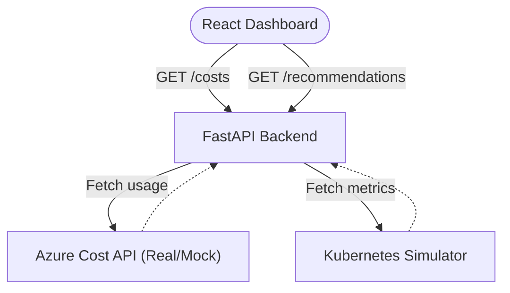
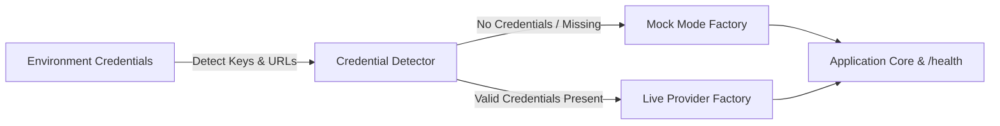

# Architecture — finops-cost-dashboard
> Last updated: 2026-08-29 | Maturity: Partial Prototype
> _FinOps dashboard with Azure Cost adapter._

## System Diagram

## Component Table
| Component | File | Responsibility | Tech |
|---|---|---|---|
| Frontend | `src/` | Interactive charts | React/Vite |
| API | `app/main.py` | Data aggregation | FastAPI |
| Azure Adapter | `app/cost/azure_client.py`| Interface to Azure Billing | Python |

## Dependency Honesty Table
| Dependency | Status | Notes |
|---|---|---|
| FastAPI | **Real** | Full API implementation. |
| React | **Real** | Client dashboard rendering. |
| Azure SDK | **Stubbed** | Interface is real, but uses mock data when credentials absent. |

## Cost Management Module
The `cost/` module wraps the Azure Cost Management API. In production, it would use `azure-mgmt-costmanagement` to query actual billing data. The mock data layer simulates realistic cost breakdowns by resource group, service, and tags (team, environment).

### Key API Endpoints
- `GET /api/v1/costs/monthly` — Full cost breakdown
- `GET /api/v1/costs/by-environment` — Costs aggregated by environment tag (prod/staging/dev)
- `GET /api/v1/costs/by-team` — Costs aggregated by team tag (showback/chargeback)

## Right-Sizing Module
The `rightsizing/` module analyzes Kubernetes pod resource utilization. It compares CPU/memory requests against actual usage (from metrics-server or Prometheus) and recommends optimal resource values.

### How Right-Sizing Works
1. Query metrics-server for actual CPU/memory consumption per pod
2. Compare against the pod's resource requests
3. If actual usage is consistently below requests, recommend a lower value
4. Calculate estimated savings percentage

## FinOps Framework Alignment
This project aligns with the FinOps Foundation's three-phase model:
- **Inform**: Cost APIs provide visibility (who is spending what, where)
- **Optimize**: Right-sizing recommendations reduce waste
- **Operate**: Tag-based aggregation enables showback/chargeback to team budgets

## Progressive Credential Loading & Production Architecture (v0.2.0)

This service implements the **Progressive Credential Loading (PCL)** pattern, decoupling development speed from external infrastructure provisioning:

### Core Architecture Components
1. **Mode Detection Singleton:** Inspects environment configuration at boot time without hard crashes on missing secrets.
2. **Dual-Mode Factory Wrappers:**
   - **Storage / Cache:** In-process maps or SQLite `:memory:` transparently promote to managed Redis or PostgreSQL when connection strings are supplied.
   - **AI Providers:** Deterministic heuristic generators and local embeddings transparently promote to live OpenAI, Anthropic, or Gemini API clients.
3. **Hot-Reload & Dynamic TLS:** File watchers monitor mounted volume paths (Kubernetes ConfigMaps and Secrets) to update certificates and limit configs atomically without process restarts.
4. **Health & Observability:** The `/health` endpoint exposes real-time runtime mode metadata (`mock` vs `live`) across all backing adapters.
